### Priyadharshan Kannan

<samp>computer science · nanyang technological university · singapore</samp>

<a href="https://kpriyadharshan.dev">website</a> ·
<a href="https://linkedin.com/in/kpriyadharshan">linkedin</a> ·
<a href="mailto:kpd2204@gmail.com">email</a> ·
<a href="https://medium.com/@kpriyadharshan">medium</a> ·
<a href="https://github.com/Dharshan2004?tab=repositories">repositories</a>

 

> I build AI tools that automate real work, then check whether their outputs
> can be trusted. Agents and evals that have to survive contact with users.

 

Computer Science undergraduate at Nanyang Technological University, graduating 
2029. Most of my time goes into agents and evaluation harnesses that run in 
real stacks: the boring bits that make a demo survive contact with users.

When I'm not at a laptop, I'm usually travelling. Mountains especially.

 

<samp>&nbsp;→&nbsp;</samp> LLM Agent Developer Intern, CyberSG R&D Programme Office (CRPO), NTU 
<samp>&nbsp;→&nbsp;</samp> AI Safety Researcher, Algoverse · Undergraduate Researcher, NTU URECA 
<samp>&nbsp;→&nbsp;</samp> Open to a full-time internship, 10 May to 13 Aug 2027

 

**LLM Agent Developer Intern** - CyberSG R&D Programme Office (CRPO), NTU 
<samp>aug 2026 - present · langgraph, langfuse, evals</samp>

Evals for cybersecurity compliance assessment: a LangGraph and Langfuse harness 
with 218 cases across 4 frameworks, comparing AI outputs against expert-labelled 
answers.

**AI Engineer Intern** - Cyber Sierra 
<samp>may 2026 - aug 2026 · react, sql, docker, kubernetes</samp>

Sole developer of a codebase knowledge agent used daily by the product team; 
helped cut cost per trace by 45% on an agent platform.

**Backend Engineer Intern, Discovery AI** - eLife Inc. 
<samp>dec 2025 - apr 2026 · python, aws sqs</samp>

Moved 6 scrapers from TypeScript to Python on AWS SQS, behind 10,000+ daily jobs.

**Backend Engineer Intern** - NetVirta, Inc. 
<samp>feb 2025 - nov 2025 · llm extraction</samp>

LLM size-chart extraction: 4 to 5 hours down to under 30 minutes per brand, 
across 80 brands.

**Campus** 
<samp>ntu ccds top'26 · ntu ccds ai/ml club</samp>

Head of Technology (Backend), NTU CCDS TOP'26, leading 7 backend engineers for 
900+ students. Director of Partnerships, NTU CCDS AI/ML Club.

 

**[ReelRank](https://github.com/Dharshan2004/reelrank)** - short-video recommender 
<samp>faiss · deepfm · mmoe · fastapi</samp>

Two-tower retrieval with FAISS, a caption safety filter, LR / DeepFM / MMoE 
ranking on KuaiRand-Pure. Recall@200 +14% vs popularity and +25% vs ItemCF over 
5 seeds. Load test: 2,890 requests, 0 failures, 100 ms p99.

**[CommentGuard](https://github.com/Dharshan2004/CommentGuard)** - toxicity classifier 
<samp>qwen3-4b · qlora · huggingface</samp>

Qwen3-4B QLoRA toxicity classifier. Frozen test F1 0.62 vs 0.27 for the base 
model and 0.35 for TF-IDF logistic regression. Weights on 
[Hugging Face](https://huggingface.co/dharshannn/CommentGuard-Qwen3-4B-MLX-LoRA).

**[Shopee Live Producer](https://github.com/Dharshan2004/shopee-live-producer)** - live-commerce co-producer 
<samp>deepagents · sea × openai hackathon</samp>

AI co-producer for live commerce, 3rd of 40 teams at the Sea × OpenAI hackathon. 
Owned the agent orchestration, including checking claims against available data 
before a reply goes out.

**[LiteLLM #31076](https://github.com/BerriAI/litellm/pull/31076)** - merged 
<samp>anthropic · cache-token reporting</samp>

Anthropic-compatible cache-token reporting across streaming and non-streaming 
paths.

 

**Algoverse** - AI Safety Researcher 
<samp>pytorch · activation patching · in progress</samp>

Why chat safety judges fail: PyTorch inference, batch screening and activation 
patching.

**NTU URECA** with Prof. Wang Chen 
<samp>multi-agent workflows · in progress</samp>

Cost, latency and quality in multi-agent scientific research workflows.

 

<samp>languages&nbsp;&nbsp;&nbsp;&nbsp;&nbsp;&nbsp;&nbsp;python, typescript, javascript, go, c++</samp> 
<samp>ai&nbsp;&nbsp;&nbsp;&nbsp;&nbsp;&nbsp;&nbsp;&nbsp;&nbsp;&nbsp;&nbsp;&nbsp;&nbsp;&nbsp;&nbsp;&nbsp;langgraph, langfuse, langchain, pytorch, qlora, llm eval</samp> 
<samp>web & data&nbsp;&nbsp;&nbsp;&nbsp;&nbsp;&nbsp;&nbsp;fastapi, next.js, react, postgresql, redis</samp> 
<samp>infrastructure&nbsp;&nbsp;&nbsp;aws (eks, sqs), kubernetes, docker</samp>

 

<samp>&nbsp;→&nbsp;</samp> <a href="https://kpriyadharshan.medium.com/building-a-voice-shopping-agent-where-the-model-talks-and-the-store-decides-4c2a9ca546c8">Building a voice shopping agent where the model talks and the store decides</a>

 

<samp>&nbsp;→&nbsp;</samp> <a href="mailto:kpd2204@gmail.com">kpd2204@gmail.com</a> 
<samp>&nbsp;→&nbsp;</samp> <a href="https://kpriyadharshan.dev">kpriyadharshan.dev</a> 
<samp>&nbsp;→&nbsp;</samp> <a href="https://linkedin.com/in/kpriyadharshan">linkedin.com/in/kpriyadharshan</a> 
<samp>&nbsp;→&nbsp;</samp> Singapore

 

ASCII ridge field from <a href="https://kpriyadharshan.dev">kpriyadharshan.dev</a>
(<code>AsciiBanner.tsx</code>), rendered as a self-typing SVG.
Headings and typeface setup adapted from
<a href="https://github.com/likalight/likalight">likalight</a>.
Typeface: <a href="https://github.com/JetBrains/JetBrainsMono">JetBrains Mono</a>, SIL OFL 1.1.

